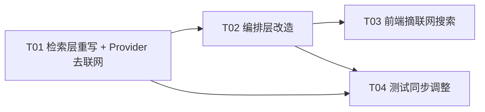
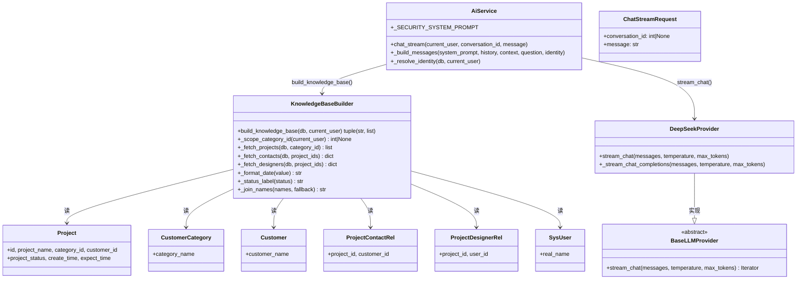
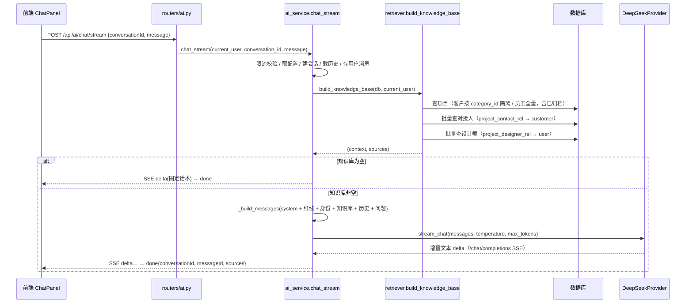

# AI 助手「检索方式改造」增量设计

> 变更主题：把 AI 助手「青青侠」的数据供给方式从 **中文关键词切分 + SQL LIKE 匹配** 改为 **结构化文本知识库 + 全量注入**，并同步摘除「联网搜索」全链路。
> 性质：**只读设计任务**，本文档不修改任何业务代码，仅供实现者（Engineer）按序落地。

---

## 1. 实现方案概述

### 1.1 改造思路

一句话：**每次提问时，实时读库 → 套用固定模板把「每个项目渲染成一条完整文本」→ 组装成知识库全文 → 无条件注入到 system prompt → 交给 LLM 作答**。

- 最小单位：**一个项目 = 一条完整文本**。
- 数据范围：**进行中 + 已归档** 全部进知识库。
- 生成时机：**实时现算**（每次提问实时读库，不做缓存/快照）。
- 注入策略：**每次提问都注入**（不做「是否业务问题」判断）。
- 数据隔离：内部员工 = 注入全部项目；客户 = 只注入 `Project.category_id == current_user.category_id` 的项目。

### 1.2 去掉什么（删除一整套）

| 删除项 | 位置 | 说明 |
|---|---|---|
| 关键词提取 `_extract_keywords` | `retriever.py` | 整段删除 |
| 意图识别 `_detect_intent` / 停用词表 `_STOPWORDS` / 统计触发词 `_STATS_TRIGGERS` | `retriever.py` | 整段删除 |
| 业务查询判断 `is_business_query` / `_BUSINESS_KEYWORDS` | `retriever.py` + `ai_service.py` 引用 | 整段删除，短路触发条件改为「知识库为空」 |
| LIKE 检索 + 落空回退全量进行中 | `retrieve_projects` | 删除，改为全量注入 |
| 统计汇总 `_compute_stats` | `retriever.py` | 删除（统计类提问现在靠模型在注入的全量知识库上自行数数） |
| 进度/节点/紧迫度：`_node_progress` / `_day_diff_label` / 节点与表单批量查询 | `retriever.py` | 删除，模板不再含这些字段 |
| 联网搜索全链路 | `deepseek.py` / `base.py` / `schemas/ai.py` / `routers/ai.py` / `ai_service.py` / 前端 4 个文件 | `/responses` 路径、`web_search` 参数、`webSearch` 透传、前端按钮全摘除 |

### 1.3 保留什么（红线不变）

1. **防幻觉红线**：知识库为空时短路返回固定话术（详见 §5），且 `_SECURITY_SYSTEM_PROMPT` 第 3 条「业务问题仅基于系统提供数据回答、无数据如实说明、严禁编造」继续保留作为非空时的二道防线。
2. **历史会话上下文**：`_load_history`（最近 10 条）不变。
3. **客户数据隔离红线**：客户账号按 `category_id` 精确隔离（数据源层面 `WHERE Project.category_id = cat_id`）。
4. **身份注入**：`_resolve_identity(db, current_user)` 不变，继续向 system 注入「你是 XX 公司的客户对接人，只能答该公司项目」/「你是内部员工，可访问全部项目」。
5. **速率限制 / 审计留痕 / 会话 CRUD**：均不变。

---

## 2. 知识库模板的精确定义

### 2.1 一条项目文本的格式

```
- 项目【{project_name}】｜客户单位：{company_name}｜对接人：{contact_names}｜我方负责人/设计师：{designer_names}｜立项时间：{create_date}｜预计结束时间：{expect_date}｜项目状态：{status_label}
```

整份知识库由 `context` 头 + 每行一条项目拼接而成：

```
系统内项目知识库（每条一行，仅据此回答项目/客户相关的业务问题，严禁编造）：
- 项目【…】｜客户单位：…｜…
- 项目【…】｜客户单位：…｜…
```

### 2.2 每个字段的取值与兜底规则

| 字段 | 数据来源 | 格式化规则 | 空值兜底 |
|---|---|---|---|
| `project_name` | `Project.project_name` | 原样输出（`strip()`） | 理论非空，仍兜底 `"未命名项目"` |
| `company_name` | `Project.category_id → CustomerCategory.category_name` | 原样输出 | `"未设置"` |
| `contact_names` | `ProjectContactRel(project_id) → Customer.customer_name`，**多人**按 `ProjectContactRel.id` 升序 | 用中文顿号 `、` 拼接 | 见 §2.3 |
| `designer_names` | `ProjectDesignerRel(project_id) → SysUser.real_name`，**多人**按 `ProjectDesignerRel.id` 升序 | 用中文顿号 `、` 拼接 | `"未分配"` |
| `create_date` | `Project.create_time` | `strftime("%Y-%m-%d")` | `"未设置"` |
| `expect_date` | `Project.expect_time` | `strftime("%Y-%m-%d")` | `"未设置"` |
| `status_label` | `Project.project_status` | `"进行中"` → `"进行中"`；`"已归档"` → `"已结项"`（已归档标注「已结项」）；其他未知值 → 原值 | — |

### 2.3 对接人（多人）的取值顺序

对接人权威来源是 `project_contact_rel`（多对多）。为保证存量数据兼容（老项目可能只在 `Project.customer_id` 存了首位对接人、没有 rel 记录），按以下顺序取：

1. `project_contact_rel` 关联出的 `customer.customer_name` 列表（多人，`、` 拼接）；
2. 若第 1 步为空 → 回退到 `Project.customer_id → Customer.customer_name`（首位对接人）；
3. 仍为空 → `"未设置"`。

> 与现状一致：不在 rel 内部去重（`customer_id` 有唯一业务约束，正常不会重复）。

### 2.4 明确「不含」的字段

模板中**严禁出现**：进度百分比、当前节点、交付紧迫度/逾期天数。这些字段的现有实现（`_node_progress`、`_day_diff_label`、`ProjectNode` / `ProjectNodeFormValue` 的批量查询）随本次改造一并删除。

### 2.5 来源列表 `sources`

`sources` 结构保持 `[{"id": project_id, "projectName": project_name}]` 不变（前端「引用自系统项目」沿用）。全量注入后，`sources` 会包含**范围内全部项目**（不再是 top_k 命中项）。

---

## 3. 文件改动清单

### 3.1 后端

| 文件 | 改动类型 | 关键改动点 |
|---|---|---|
| `backend/app/services/llm/retriever.py` | **重写** | 删除 `is_business_query` / `_extract_keywords` / `_detect_intent` / `_compute_stats` / `_day_diff_label` / `_node_progress` / `_build_rich_context` / `retrieve_projects` 及全部常量表；新增 `build_knowledge_base(db, current_user)` 及辅助函数（见 §4） |
| `backend/app/services/ai_service.py` | 改 | ① `from ...retriever import is_business_query, retrieve_projects` → `from ...retriever import build_knowledge_base`；② `_build_messages(...)` 删除 `web_search` 形参与联网提示 system 块；③ `chat_stream(...)` 删除 `web_search` 形参；④ L335–344 改为「`context, sources = build_knowledge_base(db, current_user)` + 空知识库短路」；⑤ `provider.stream_chat(messages, temperature, max_tokens)` 去掉 `web_search=` |
| `backend/app/services/llm/deepseek.py` | 改 | 删除 `_stream_responses` 与 `_split_messages` 两个函数；`stream_chat(self, messages, temperature, max_tokens)` 直接 `yield from self._stream_chat_completions(...)`；更新模块 docstring |
| `backend/app/services/llm/base.py` | 改 | 抽象方法签名去掉 `web_search: bool = False`，删掉 docstring 中联网描述 |
| `backend/app/services/llm/__init__.py` | **不改** | `get_provider` 工厂不涉及 `web_search`，确认无需改动 |
| `backend/app/schemas/ai.py` | 改 | `ChatStreamRequest` 删除 `web_search: bool = Field(default=False)` 字段，更新类 docstring |
| `backend/app/routers/ai.py` | 改 | `chat_stream` 端点：`ai_service.chat_stream(current_user, req.conversation_id, req.message)`（去掉 `req.web_search`） |

### 3.2 前端

| 文件 | 改动类型 | 关键改动点 |
|---|---|---|
| `frontend/src/components/ai/ChatInput.vue` | 改 | 删除 `search-toggle` 按钮及 `webSearch` ref；`emit('send', val, webSearch.value)` → `emit('send', val)`；删除未再使用的 `Search` 图标导入与 `.search-toggle` 样式 |
| `frontend/src/components/ai/ChatPanel.vue` | 改 | `function onSend(message, webSearch)` → `function onSend(message)`；`aiStore.sendMessage(message)`（去掉第二参） |
| `frontend/src/stores/ai.js` | 改 | `sendMessage(message, webSearch = false)` → `sendMessage(message)`；调用 `chatStream({...})` 去掉 `webSearch` 字段与 JSDoc |
| `frontend/src/api/ai.js` | 改 | `chatStream({ conversationId, message, webSearch = false, ... })` → 去掉 `webSearch` 形参；`body` 去掉 `webSearch` 字段与 JSDoc |
| `frontend/src/components/ai/MessageList.vue` | **不改** | 已确认无 `webSearch` 引用 |
| `frontend/dist/**` | 重新构建生成 | 构建产物，不手改（`npm run build` 自动刷新） |

### 3.3 测试

| 文件 | 改动类型 | 关键改动点 |
|---|---|---|
| `backend/tests/qa_retriever_verify.py` | **重写** | 旧断言全部针对关键词/意图/统计/LIKE/紧急度排序/节点进度，需改为断言新 `build_knowledge_base` 行为（见 §6 T04）。注意：客户账号 dict 需改为携带 `category_id`（旧代码用 `customer_id`） |
| `backend/tests/ai_full_check.py` | 改 | ① `retrieve_projects(db, cur, msg, top_k=8)` → `build_knowledge_base(db, cur)`；② 删除关键词/`is_business_query`/联网（3d、3e）断言；③ 客户账号 dict 补 `category_id`；④ 删除「实体落空回退」断言（不再有回退）；⑤ 短路触发改为「知识库为空即短路」 |
| `backend/tests/full_flow_check.py` | **基本不改** | 已确认 AI 段不发送 `webSearch`，仅断言 `done` 事件送达，兼容本次改动 |
| `backend/tests/mock_llm.py` | 可选清理 | 后端不再调用 `/responses`，可删除 `_handle_responses` 与 `/responses` 分支（保留亦无害） |

---

## 4. 核心函数设计

### 4.1 `build_knowledge_base` 接口签名

```python
# backend/app/services/llm/retriever.py（重写后）

def build_knowledge_base(db: Session, current_user: dict) -> tuple[str, list[dict]]:
    """实时现算结构化知识库（每次提问调用，不做缓存/快照）。

    返回：
        context : str         知识库全文（含表头 + 每项目一行）
        sources : list[dict]  来源列表 [{id, projectName}]（范围内全部项目）

    隔离口径：
        - 内部员工（role != "客户"）→ 全量项目
        - 客户（role == "客户"）  → 仅 Project.category_id == current_user["category_id"]
    """
```

### 4.2 内部辅助函数

```python
def _scope_category_id(current_user: dict) -> int | None:
    """客户账号返回其 category_id（用于 WHERE 隔离）；内部员工返回 None（全量）。"""

def _format_date(value) -> str:
    """datetime → 'YYYY-MM-DD'；None/空 → '未设置'。"""

def _status_label(status: str | None) -> str:
    """'进行中'→'进行中'；'已归档'→'已结项'；其他/空→原值或'未知'。"""

def _join_names(names: list[str], fallback: str) -> str:
    """非空列表用 '、' 拼接，空列表返回 fallback。"""

def _fetch_projects(db, category_id: int | None) -> list[tuple[Project, str | None, str | None]]:
    """主查询，返回 (Project, 客户单位名, 首位对接人名)。"""

def _fetch_contacts(db, project_ids: list[int]) -> dict[int, list[str]]:
    """批量取对接人（project_contact_rel → customer.customer_name），避免 N+1。"""

def _fetch_designers(db, project_ids: list[int]) -> dict[int, list[str]]:
    """批量取我方设计师/负责人（project_designer_rel → sys_user.real_name），避免 N+1。"""
```

### 4.3 SQL 查询要点

**主查询 `_fetch_projects`**（SQLAlchemy）：

```python
stmt = (
    select(Project, CustomerCategory.category_name, Customer.customer_name)
    .outerjoin(CustomerCategory, CustomerCategory.id == Project.category_id)   # 客户单位名
    .outerjoin(Customer, Customer.id == Project.customer_id)                    # 首位对接人（回退用）
)
if category_id is not None:                       # 客户隔离：按 category_id 精确过滤
    stmt = stmt.where(Project.category_id == category_id)
stmt = stmt.order_by(Project.create_time.desc(), Project.id.desc())            # 最新在前
```

要点：
- **不做 `project_status` 过滤**：进行中 + 已归档全量入知识库。
- **客户隔离在 SQL 层**完成（`WHERE category_id = :cat_id`），不靠 Python 过滤，从数据源杜绝跨公司泄露。
- 客户账号 `category_id` 缺失（`None`）→ 直接返回 `("", [])`，等同「无数据」。

**批量取对接人 `_fetch_contacts`**（避免 N+1）：

```python
rows = db.execute(
    select(ProjectContactRel.project_id, Customer.customer_name)
    .join(Customer, Customer.id == ProjectContactRel.customer_id)
    .where(ProjectContactRel.project_id.in_(project_ids))
    .order_by(ProjectContactRel.id)              # 稳定顺序（多人名拼接顺序）
).all()
```

**批量取设计师 `_fetch_designers`**（避免 N+1）：

```python
rows = db.execute(
    select(ProjectDesignerRel.project_id, SysUser.real_name)
    .join(SysUser, SysUser.id == ProjectDesignerRel.user_id)
    .where(ProjectDesignerRel.project_id.in_(project_ids))
    .order_by(ProjectDesignerRel.id)
).all()
```

> 现有 `_build_rich_context` 里的节点/表单批量查询（`ProjectNode`、`ProjectNodeFormValue`）**整体移除**——模板不再需要进度/当前节点。

### 4.4 `ai_service.py` 编排改造要点

```python
# 原 L335-344：
#   context, sources = retrieve_projects(db, current_user, message, top_k=8)
#   identity = _resolve_identity(db, current_user)
#   if not context and is_business_query(message): ...短路...
#   else: messages = _build_messages(..., web_search); provider.stream_chat(..., web_search=web_search)

# 新逻辑：
context, sources = build_knowledge_base(db, current_user)
identity = _resolve_identity(db, current_user)

if not context:                                    # 防幻觉红线：知识库为空 → 短路，不调 LLM
    assistant_text = _EMPTY_KB_REPLY               # 固定话术，见 §5
    yield _sse({"type": "delta", "content": assistant_text})
    assistant_id = _save_message(db, conv.id, "assistant", assistant_text, [])
else:
    messages = _build_messages(config.system_prompt, history, context, message, identity)
    provider = get_provider(config)
    for delta in provider.stream_chat(messages, config.temperature, config.max_tokens):
        ...
```

`_build_messages` 新签名：

```python
def _build_messages(system_prompt, history, context, question, identity=None) -> list[dict]:
```

注入知识库的 system 块文案（替换原「以下是系统内与你相关的项目数据…」）：

```
以下是系统内完整的项目知识库（每条一行代表一个项目）。请仅基于这些数据回答与项目/客户相关的业务问题，严禁编造；若问题与这些数据无关，则正常作答：
<context>
```

### 4.5 Provider 层签名变化

```python
# base.py（抽象）
def stream_chat(self, messages, temperature=0.7, max_tokens=2048) -> Iterator[str]:
    ...

# deepseek.py（实现）
def stream_chat(self, messages, temperature=0.7, max_tokens=2048):
    yield from self._stream_chat_completions(messages, temperature, max_tokens)
```

---

## 5. 防幻觉「空知识库」处理方案（明确建议）

**推荐方案：知识库为空 → 无条件短路返回固定话术（不调 LLM）+ 保留提示词约束作为二道防线。**

理由：
- 需求已明确「去掉 `is_business_query`、不做任何是否业务问题的判断」，因此**无法再安全区分「闲聊」与「业务问题」**。保留旧「业务查询 + 空才短路」的判断已不可行。
- 青青侠定位是「项目数据助手」。在知识库为空（用户可见范围内没有任何项目）时，任何提问都返回固定话术，是最确定、零幻觉风险的做法。
- `_SECURITY_SYSTEM_PROMPT` 第 3 条继续保留，覆盖「知识库非空但答案越界」的场景，作为第二道防线。

固定话术建议（可微调，但语义固定）：

```
我在系统里暂时没有查到你有权限访问的项目数据哦～如有需要，可到「项目列表」确认，或联系管理员。
```

> 提示词约束仍保留：`_SECURITY_SYSTEM_PROMPT` 全文不变；非空时它约束模型「仅基于提供的知识库作答、无数据如实说明、严禁编造」。

---

## 6. 任务列表（有序、含依赖）

> 按「先数据/Provider 层 → 再编排层 → 再前端 → 最后测试」分层推进，共 4 个任务。

| Task | 名称 | 改动文件 | 依赖 | 优先级 |
|---|---|---|---|---|
| T01 | 后端检索层重写 + Provider 去联网 | `backend/app/services/llm/retriever.py`、`backend/app/services/llm/deepseek.py`、`backend/app/services/llm/base.py` | — | P0 |
| T02 | 后端编排层改造（全量注入 + 空库短路 + 摘 web_search 契约） | `backend/app/services/ai_service.py`、`backend/app/schemas/ai.py`、`backend/app/routers/ai.py` | T01 | P0 |
| T03 | 前端摘除联网搜索 | `frontend/src/components/ai/ChatInput.vue`、`frontend/src/components/ai/ChatPanel.vue`、`frontend/src/stores/ai.js`、`frontend/src/api/ai.js` | T02 | P1 |
| T04 | 测试同步调整 | `backend/tests/qa_retriever_verify.py`、`backend/tests/ai_full_check.py`、`backend/tests/mock_llm.py`（`full_flow_check.py` 确认无需改） | T01、T02 | P1 |

### 各任务具体内容

**T01 — 后端检索层重写 + Provider 去联网**
- `retriever.py`：删除 §1.2 列出的全部旧函数/常量，新增 `build_knowledge_base` + `_scope_category_id` / `_format_date` / `_status_label` / `_join_names` / `_fetch_projects` / `_fetch_contacts` / `_fetch_designers`（§4）。
- `deepseek.py`：删 `_stream_responses`、`_split_messages`；`stream_chat` 只走 `/chat/completions`。
- `base.py`：抽象 `stream_chat` 去掉 `web_search`。

**T02 — 后端编排层改造**
- `ai_service.py`：改 import、`_build_messages`、`chat_stream`，接入 `build_knowledge_base` + 空库短路（§4.4、§5）。
- `schemas/ai.py`：`ChatStreamRequest` 删 `web_search`。
- `routers/ai.py`：`chat_stream` 不再透传 `req.web_search`。

**T03 — 前端摘除联网搜索**
- 4 个文件按 §3.2 摘除 `webSearch` 透传与「联网搜索」按钮。

**T04 — 测试同步调整**
- `qa_retriever_verify.py` 重写为 `build_knowledge_base` 行为证明，建议覆盖：
  1. 员工全量：进行中 + 已归档都出现；
  2. 客户按 `category_id` 隔离：只见本单位、不见他单位；
  3. 模板字段：客户单位 / 多人对接人（`、` 拼接）/ 多人设计师 / `YYYY-MM-DD` 时间 / 已归档标注 `已结项`；
  4. 模板「不含」：`进度`、`当前节点`、`逾期`、`剩余` 等字样不出现；
  5. 空知识库：无项目客户 → `("", [])`；`ai_service.chat_stream` 短路返回「没查到」且不调 LLM；
  6. 客户账号 dict 改用 `category_id`（不再用 `customer_id`）。
- `ai_full_check.py`：按 §3.3 同步；删除联网用例（3d/3e）与关键词/业务判定用例；`retrieve_projects` → `build_knowledge_base`；客户 dict 补 `category_id`。
- `mock_llm.py`：可选删除 `/responses` 分支。
- `full_flow_check.py`：确认无需改（不发送 `webSearch`，只断言 `done`）。

### 任务依赖图



---

## 7. 待明确事项

1. **已归档标注文案**：本设计采用 `已归档 → "已结项"`（直接输出）。若产品希望保留原始枚举，可改为 `"已归档（已结项）"`，仅影响 `_status_label` 一处。
2. **空知识库是否区分闲聊**：需求已明确「不做业务问题判断」，故本设计对**空知识库一律短路**。副作用是：无项目的客户说「你好」也会得到「没查到项目数据」。若产品希望空库时仍支持纯闲聊，需另加极简问候兜底（与当前需求相悖，默认不做，需产品拍板）。
3. **`sources` 全量长度**：全量注入后前端「引用自系统项目」会列出范围内全部项目名。本设计保持全量；如需限制展示条数，由前端截断（后端契约不变）。
4. **全量注入的项目排序**：需求未明确，本设计默认 `create_time desc, id desc`（最新在前）。若需按状态分组/立项时间正序，调整 `_fetch_projects` 的 `order_by` 即可。
5. **项目量级的 token 上限风险**：项目数很大时，全量注入可能逼近上下文上限或显著增加 token 消耗。需求明确「全量注入」，本设计不做截断；若未来需要，建议在 `build_knowledge_base` 加一条条数上限并附带「已截断，共 N 条」提示——**本次不实现，仅提示风险**。
6. **过时文档**：`docs/程序开发人员看/…`、`artifacts/…`、`backend/README.md`、`frontend/README.md` 中关于「关键词检索 / 联网搜索」的旧描述已过时，是否同步更新属文档任务，不在本次代码改造范围内。

---

## 附录 A：类图（数据结构与关键函数）



## 附录 B：时序图（一次提问的调用流）


