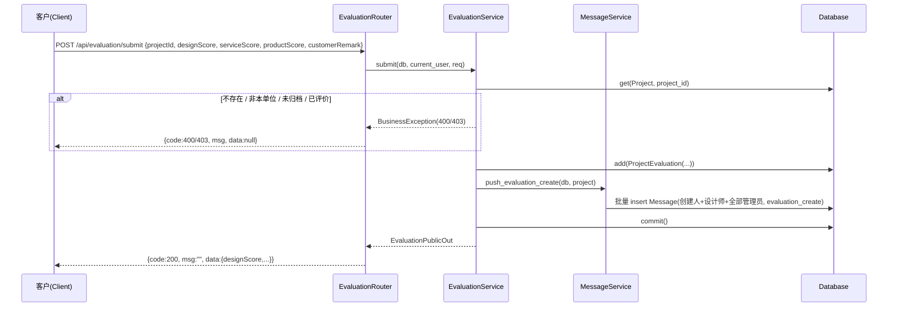
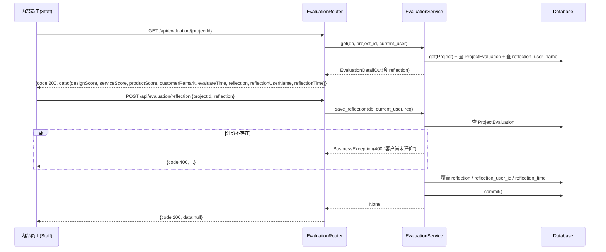
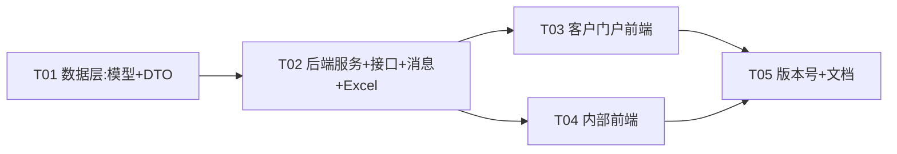

# LINKOA V1.4.17 — 客户满意度评价 增量设计 + 任务分解

> 架构师：Bob（software-architect）
> 目标版本：V1.4.16 → V1.4.17
> 配套 PRD：`docs/程序开发人员看/领客文创OA_V1_客户满意度评价_PRD.md`
> 技术栈（沿用，不引入新框架）：FastAPI + SQLAlchemy 2.0（`Mapped`/`mapped_column`） + Pydantic v2（`CamelModel`）+ Vue3 + Vite + Element Plus（星评用 `el-rate`）+ Pinia + Axios

---

# Part A：系统设计

## 1. 实现方案 + 框架选型

### 1.1 核心难点与对策

| 难点 | 对策 |
|---|---|
| 一个项目一条评价、提交后一次性锁定 | `project_evaluation.project_id` 建 **UNIQUE 唯一索引** + **service 层提交前 `SELECT` 二次校验**，双保险拒绝二次提交；前端不提供修改入口 |
| 客户单位级唯一（同单位任意账号只评一次） | 唯一约束挂在 `project_id` 上（而非"单位+项目"），天然满足"一条项目一条评价"；客户隔离用 `current_user["category_id"] == project.category_id` 校验 |
| 客户评价与内部反思彻底隔离（反思客户永远不可见） | 出参拆成 **公开 DTO（无 reflection）** 与 **内部 DTO（含 reflection）**；客户接口/详情一律只回公开字段，反思仅在内部 `GET /api/evaluation/{projectId}` 返回 |
| 新表在存量库上自动创建 | 项目已有 `init_database()` 启动期执行 `Base.metadata.create_all(bind=engine)`（见 `backend/app/main.py:210`）。**新表只要注册进 `models/__init__.py` 即会在下次启动自动建表**；`auto_add_missing_columns()` 只负责"补列"，不涉及新表。无需手写迁移脚本 |
| 通知复用现有消息机制 | 复用 `message` 表 + `message_service.py`，新增消息类型 `evaluation_create`；接收人 = 项目创建人 + 全部关联设计师 + 全部 `role=管理员` 账号 |
| Excel 追加 6 列 | 在 `excel_service.export_projects` 现有 7 列后追加；`ProjectEvaluation` 按 `project_id IN (...)` 批量取回，避免 N+1 |

### 1.2 关键现状确认（已读代码，勿臆测）

- **建表时机**：`main.py:lifespan → init_database()` 中 `Base.metadata.create_all(bind=engine)` 先建新表，随后 `auto_add_missing_columns()` 补列。`init_database` 内 `from app.models import SysUser` 会触发 `models/__init__.py` 全量注册，因此**新增 `ProjectEvaluation` 模型并加入 `models/__init__.py` 后，`create_all` 自动建表**，`UNIQUE` 约束随建表一并生效。SQLite 索引名前缀由 `prepare_sqlite_indexes()` 统一加表名前缀（仅 `table.indexes`，唯一列约束不受影响）。
- **当前用户结构**（`dependencies.get_current_user` 返回 dict）：`{id, username, real_name, role, dept_id, customer_id, category_id, is_enable}`。客户账号 `role == "客户"`，且 `category_id` 直绑客户单位（V1.4.15 起，`_resolve_user_category_id` 直取 `current_user["category_id"]`）。
- **隔离口径**：`project_service.project_list/project_detail` 中客户按 `Project.category_id == current_user.category_id` 过滤/校验；内部全量。
- **消息机制**：`message_service.push(db, project, operator_id, operator_name, msg_type, ...)` 现支持 5 种类型，接收人 = 创建人 + 设计师 − 操作人（`_recipients`）。`msg_type` 是 `String(64)` 无枚举约束，新增类型**不需要改表**。前端 `views/message/Index.vue` 的 `TYPE_LABELS` 映射需补 `evaluation_create`。
- **Excel 导出**：`HEADERS`/`COL_WIDTHS` 现 7 列，`export_projects` 逐行写值；`report.py` 的 `GET /api/report/exportProject` 仅 `管理员` 可调，无需改动路由。
- **版本号散落点**：`backend/app/main.py`（`FastAPI(version="1.4.16")`）、`frontend/src/views/login/Index.vue`（`const version = '1.4.16'`），以及 9 份 MD 文档（README、backend/README、frontend/README、`docs/程序开发人员看/` 下 6 份）。

### 1.3 架构模式

沿用现有分层：**Router（`routers/`）→ Service（`services/`）→ Model（`models/`）+ Schema（`schemas/`）**，不引入新抽象。新增独立的 `evaluation` 四件套（model/schema/service/router），与现有 `project`/`comment` 模块同构，保持松散耦合。

---

## 2. 文件清单

### 2.1 后端（backend/app/）

**新增：**

| 相对路径 | 说明 |
|---|---|
| `backend/app/models/evaluation.py` | `ProjectEvaluation` ORM 模型 |
| `backend/app/schemas/evaluation.py` | 评价相关 DTO（提交/反思/出参） |
| `backend/app/services/evaluation_service.py` | 评价提交/查询/反思业务逻辑 |
| `backend/app/routers/evaluation.py` | 评价 API 路由（前缀 `/api/evaluation`） |

**修改：**

| 相对路径 | 改动点 |
|---|---|
| `backend/app/models/__init__.py` | 注册 `ProjectEvaluation`（import + `__all__`） |
| `backend/app/schemas/__init__.py` | 导出评价 DTO |
| `backend/app/schemas/project.py` | `ProjectListItem` / `ProjectDetail` 新增 `evaluation` 字段 |
| `backend/app/services/project_service.py` | 列表/详情批量填充 `evaluation`；`project_delete` 级联删除评价 |
| `backend/app/services/message_service.py` | 新增 `push_evaluation_create` + 管理员接收人 |
| `backend/app/services/excel_service.py` | `HEADERS`/`COL_WIDTHS` 追加 6 列 + 写入评价数据 |
| `backend/app/main.py` | 注册 `evaluation` 路由；`FastAPI(version="1.4.17")` |

> 说明：`backend/app/routers/report.py` **无需改动**（`export_project` 已直接调用 `excel_service.export_projects`）；`backend/app/routers/project.py` **无需改动**（list/detail 已在 service 内组装）。

### 2.2 前端（frontend/src/）

**新增：**

| 相对路径 | 说明 |
|---|---|
| `frontend/src/api/evaluation.js` | 评价 API 封装（submit / get / saveReflection） |
| `frontend/src/components/EvaluationStars.vue` | 只读三星展示组件（支持低分标红，客户卡片/内部列表弹窗/详情区块复用） |

**修改：**

| 相对路径 | 改动点 |
|---|---|
| `frontend/src/views/client/Index.vue` | 卡片「去评价」按钮 + 评价弹窗（3 项 `el-rate` + 备注 + 二次确认）+ 已评价「查看评论」按钮 + 查看弹窗（V1.4.17 改版：不再平铺星星） |
| `frontend/src/views/project/List.vue` | 卡片「暂未评价」/「查看评价」+ 查看评价弹窗 |
| `frontend/src/views/project/Detail.vue` | 「客户评价」区块 + 「反思/总结」编辑 + 低分标红 |
| `frontend/src/views/message/Index.vue` | `TYPE_LABELS` 补 `evaluation_create: '客户评价'` |
| `frontend/src/views/login/Index.vue` | `const version = '1.4.17'` |

> 说明：`frontend/src/views/client/Project.vue`（客户详情页）**本次不改**——需求仅要求客户门户**卡片**展示评价入口与结果；`frontend/src/api/project.js` **无需改动**（list/detail 的 `evaluation` 字段由既有接口返回，直接消费）。

---

## 3. 数据结构与接口设计

### 3.1 `project_evaluation` 表 DDL

```sql
-- 兼容 SQLite（AUTOINCREMENT）与 MySQL（AUTO_INCREMENT），由 SQLAlchemy 生成
CREATE TABLE project_evaluation (
    id                BIGINT       PRIMARY KEY AUTOINCREMENT,
    project_id        BIGINT       NOT NULL,
    design_score      SMALLINT     NOT NULL,          -- 设计满意度 1~5
    service_score     SMALLINT     NOT NULL,          -- 服务响应速度 1~5
    product_score     SMALLINT     NOT NULL,          -- 最终产品 1~5
    customer_remark   TEXT         NULL,              -- 客户备注（选填）
    evaluate_user_id  BIGINT       NOT NULL,          -- 评价人 sys_user.id（客户账号）
    evaluate_time     DATETIME     NOT NULL,          -- 评价时间
    reflection        TEXT         NULL,              -- 反思/总结（内部可见，客户不可见）
    reflection_user_id BIGINT      NULL,              -- 反思编辑人 sys_user.id
    reflection_time   DATETIME     NULL,              -- 反思编辑时间
    create_time       DATETIME     NOT NULL DEFAULT CURRENT_TIMESTAMP,
    update_time       DATETIME     NOT NULL DEFAULT CURRENT_TIMESTAMP,
    CONSTRAINT uk_project_evaluation_project_id UNIQUE (project_id)
);
CREATE INDEX idx_project_evaluation_project_id ON project_evaluation(project_id); -- 唯一约束已覆盖，此普通索引可选
```

### 3.2 SQLAlchemy 模型（`models/evaluation.py`）

```python
from datetime import datetime
from sqlalchemy import BigInteger, DateTime, Index, SmallInteger, Text, func
from sqlalchemy.orm import Mapped, mapped_column
from app.database import Base

class ProjectEvaluation(Base):
    __tablename__ = "project_evaluation"
    __table_args__ = (
        Index("uk_project_evaluation_project_id", "project_id", unique=True),
    )

    id: Mapped[int] = mapped_column(primary_key=True, autoincrement=True, comment="主键自增")
    project_id: Mapped[int] = mapped_column(BigInteger, nullable=False, comment="项目ID（project.id，唯一，一个项目一条评价）")
    design_score: Mapped[int] = mapped_column(SmallInteger, nullable=False, comment="设计满意度 1~5")
    service_score: Mapped[int] = mapped_column(SmallInteger, nullable=False, comment="服务响应速度 1~5")
    product_score: Mapped[int] = mapped_column(SmallInteger, nullable=False, comment="最终产品满意度 1~5")
    customer_remark: Mapped[str | None] = mapped_column(Text, nullable=True, comment="客户备注（选填）")
    evaluate_user_id: Mapped[int] = mapped_column(BigInteger, nullable=False, comment="评价人ID（sys_user.id，客户账号）")
    evaluate_time: Mapped[datetime] = mapped_column(DateTime, nullable=False, server_default=func.now(), comment="评价时间")
    reflection: Mapped[str | None] = mapped_column(Text, nullable=True, comment="内部反思/总结（客户不可见）")
    reflection_user_id: Mapped[int | None] = mapped_column(BigInteger, nullable=True, comment="反思编辑人ID")
    reflection_time: Mapped[datetime | None] = mapped_column(DateTime, nullable=True, comment="反思编辑时间")
    create_time: Mapped[datetime] = mapped_column(DateTime, nullable=False, server_default=func.now(), comment="创建时间")
    update_time: Mapped[datetime] = mapped_column(DateTime, nullable=False, server_default=func.now(), onupdate=func.now(), comment="更新时间")
```

> 注意：`evaluate_time` 建议在 service 层显式 `datetime.now()` 赋值（与 `evaluate_user_id` 同事务落库，语义清晰）；`reflection_time` 同理在更新时显式赋值。

### 3.3 DTO（`schemas/evaluation.py`）

```python
# 入参
class EvaluationSubmitRequest(CamelModel):
    project_id: int = Field(..., gt=0)
    design_score: int = Field(..., ge=1, le=5)
    service_score: int = Field(..., ge=1, le=5)
    product_score: int = Field(..., ge=1, le=5)
    customer_remark: str | None = Field(None, max_length=2000)

class ReflectionSaveRequest(CamelModel):
    project_id: int = Field(..., gt=0)
    reflection: str = Field(..., min_length=1, max_length=5000)

# 出参：公开（客户/内部通用，不含 reflection）
class EvaluationPublicOut(CamelModel):
    design_score: int
    service_score: int
    product_score: int
    customer_remark: str | None = None
    evaluate_time: datetime | None = None

# 出参：内部（含反思，仅内部接口返回）
class EvaluationDetailOut(EvaluationPublicOut):
    reflection: str | None = None
    reflection_user_name: str | None = None
    reflection_time: datetime | None = None
```

`schemas/project.py` 追加字段：

```python
class ProjectListItem(CamelModel):
    ...
    evaluation: EvaluationPublicOut | None = None   # 已评价才非空；客户/内部列表通用

class ProjectDetail(CamelModel):
    ...
    evaluation: EvaluationPublicOut | None = None   # 公开字段；反思走内部 GET /api/evaluation/{projectId}
```

### 3.4 新增 API 接口清单

统一响应体沿用 `{code, msg, data}`（`ok()` / `fail()`）；字段风格后端 `snake_case`、接口 `camelCase`（`CamelModel` 自动转换）。

| # | 方法 | 路径 | 权限/隔离 | 入参 | 出参（data） |
|---|---|---|---|---|---|
| 1 | POST | `/api/evaluation/submit` | `require_roles("客户")`；校验 `project.category_id == current_user.category_id`、`project.project_status == "已归档"`、该项目无既有评价 | `EvaluationSubmitRequest` | 新建的 `EvaluationPublicOut` |
| 2 | GET | `/api/evaluation/{projectId}` | 登录用户；客户校验 `category_id` 隔离；**客户不返回 reflection 字段**，内部返回 `EvaluationDetailOut` | 路径参数 `projectId` | 客户→`EvaluationPublicOut`；内部→`EvaluationDetailOut`；无评价→`null` |
| 3 | POST | `/api/evaluation/reflection` | `require_not_customer()`（所有内部员工）；评价须已存在 | `ReflectionSaveRequest` | `null` |

**接口 1 — 客户提交评价（核心）**

- 权限：`Depends(require_roles("客户"))`
- service 校验顺序（任一不满足抛 `BusinessException`）：
  1. `project = get_project_or_400(db, project_id)`（不存在 400）；
  2. `project.category_id != current_user["category_id"]` → 403「无权评价该项目」；
  3. `project.project_status != "已归档"` → 400「项目尚未归档，暂不能评价」；
  4. `select(ProjectEvaluation).where(project_id==...)` 已存在 → 400「该项目已评价，不可重复提交」；
- 落库：`ProjectEvaluation(project_id, design/service/product_score, customer_remark, evaluate_user_id=current_user.id, evaluate_time=datetime.now())`；
- 触发通知：`message_service.push_evaluation_create(db, project)`（不 commit，随调用方事务提交）；
- `db.commit()`，返回 `EvaluationPublicOut`。

**接口 2 — 查询评价**

- 客户：校验 `category_id` 隔离后，返回公开 DTO（**不拼 reflection**）；
- 内部：返回 `EvaluationDetailOut`（含 `reflection` / `reflection_user_name` / `reflection_time`）；`reflection_user_name` 通过 `db.get(SysUser, reflection_user_id)` 取 `real_name`（已删用户兜底「已删除用户」）。

**接口 3 — 写反思（覆盖式）**

- 权限：`Depends(require_not_customer())`；
- 校验：评价须已存在 → 否则 400「客户尚未评价，暂不能填写反思」；
- 覆盖更新：`reflection = req.reflection`、`reflection_user_id = current_user.id`、`reflection_time = datetime.now()`；`commit()`。

### 3.5 列表/详情带出评价字段

- `project_service.project_list`：对当前页 `project_ids` 批量 `select(ProjectEvaluation).where(project_id.in_(ids))` 组装 `{project_id: EvaluationPublicOut}`，填入 `ProjectListItem.evaluation`（无评价为 `None`）。
- `project_service.project_detail`：单条查评价填入 `ProjectDetail.evaluation`（公开字段）；**反思不入 detail**，由内部前端另调接口 2 获取。
- `project_service.project_delete`：在级联删除段落追加 `db.execute(delete(ProjectEvaluation).where(ProjectEvaluation.project_id == project_id))`，避免孤儿评价。

### 3.6 消息通知触发点

在 `message_service.py` 新增：

```python
def push_evaluation_create(db: Session, project: Project) -> None:
    """客户提交评价后通知：创建人 + 关联设计师 + 全部 role=管理员（不 commit，随调用方事务提交）"""
    ids = _recipients(db, project, operator_id=-1)   # -1 不会命中任何用户，等价于不排除操作人
    admin_ids = db.execute(select(SysUser.id).where(SysUser.role == "管理员")).scalars().all()
    ids.update(admin_ids)
    existing = set(db.execute(select(SysUser.id).where(SysUser.id.in_(ids))).scalars().all())
    content = f"客户已对项目「{project.project_name}」提交满意度评价"
    for uid in (ids & existing):
        db.add(Message(receive_user_id=uid, project_id=project.id,
                       msg_type="evaluation_create", msg_content=content, is_read=0))
```

> 操作人为客户，不在「创建人/设计师/管理员」集合内，故无需显式排除。前端消息中心点击仍按既有逻辑跳 `/projects/{projectId}`。

---

## 4. 程序调用流程（时序图）

### 4.1 客户提交评价 → 落库 → 发消息



### 4.2 内部查看评价 + 写反思



---

## 5. Anything UNCLEAR（待明确事项）

1. **反思写权限**：需求定稿为「所有内部员工可写」（实现 `require_not_customer`）；PRD 第 6 节又建议收窄为「参与人 + 管理员」。**本设计按定稿「所有内部员工可写」实现**，若产品倾向收窄请 team-lead 拍板（影响接口 3 的权限依赖）。
2. **客户备注 / 反思长度上限**：PRD 未定。建议 `customer_remark ≤ 2000`、`reflection ≤ 5000`（`Text` 库层不限，schema 层校验）。
3. **取消归档边界**：已按 P1-2 处理——评价数据不随状态回退丢失，仅前端隐藏「去评价」入口；已提交评价在详情页保留。
4. **项目删除级联**：已明确 `project_delete` 需同步删除 `project_evaluation`（避免孤儿数据）；若希望"删除项目也保留评价"另议。
5. **低分标红范围**：已按 PRD 建议——详情页区块 + 「查看评价」弹窗同时标红（任一单项 ≤2 星）。
6. **Excel 得分格式**：数字 1~5，未评价留空（不做星级字符串）。

---

# Part B：任务分解

## 6. Required Packages（依赖包）

**无新增依赖。** 说明：
- 后端复用现有 `fastapi / sqlalchemy>=2.0 / pydantic>=2.0 / openpyxl`（Excel 已用），`SmallInteger`/`BigInteger`/`Text`/`Index` 均为 SQLAlchemy 内置；
- 前端星评用 Element Plus 内置 `el-rate`，无需引入第三方星评库；
- 不新增 npm / pip 包，`requirements.txt`、`package.json` 均不改。

## 7. 任务列表（有序，含依赖）

> 说明：按「模型/数据 → 后端服务接口 → 客户前端 → 内部前端 → 版本与文档」顺序拆成 5 个任务（≤5 上限）。将 team-lead 建议的「T05 Excel导出与消息」并入后端服务任务，「T06 版本号与文档」保留为 T05。

| 任务 | 名称 | 源文件 | 依赖 | 优先级 |
|---|---|---|---|---|
| **T01** | 数据层：模型 + 建表 + DTO | `backend/app/models/evaluation.py`（新）、`backend/app/models/__init__.py`、`backend/app/schemas/evaluation.py`（新）、`backend/app/schemas/__init__.py`、`backend/app/schemas/project.py` | 无 | P0 |
| **T02** | 后端服务 + 接口 + 消息 + Excel | `backend/app/services/evaluation_service.py`（新）、`backend/app/routers/evaluation.py`（新）、`backend/app/services/project_service.py`、`backend/app/services/message_service.py`、`backend/app/services/excel_service.py`、`backend/app/main.py` | T01 | P0 |
| **T03** | 客户门户前端（评价提交） | `frontend/src/api/evaluation.js`（新）、`frontend/src/components/EvaluationStars.vue`（新）、`frontend/src/views/client/Index.vue` | T02 | P0 |
| **T04** | 内部前端（查看评价 + 反思） | `frontend/src/views/project/List.vue`、`frontend/src/views/project/Detail.vue`、`frontend/src/views/message/Index.vue` | T02 | P0 |
| **T05** | 版本号与文档收口 | `frontend/src/views/login/Index.vue`、README.md、backend/README.md、frontend/README.md、`docs/程序开发人员看/` 下 6 份 MD | T01–T04 | P1 |

> `frontend/src/components/EvaluationStars.vue` 在 T03 创建，T04 复用（内部列表弹窗/详情区块）。

## 8. Shared Knowledge（共享约定，跨文件）

- **响应体**：全部接口 `{code, msg, data}`；成功 `code=200`，业务失败 `code` 为 400/403/500（HTTP 状态码恒 200）；用 `ok()/fail()` 包装。
- **字段命名**：后端 Python/Pydantic 用 `snake_case`，序列化后接口用 `camelCase`（`CamelModel` 自动转换）；前端 `request.js` 拦截器已解包 `data`。
- **当前用户**：`current_user` 为 dict，含 `id / role / category_id`；客户 `role == "客户"` 且 `category_id` 直绑公司；内部员工 `role != "客户"`。
- **隔离口径**：客户可见/可评范围 = `project.category_id == current_user["category_id"]`；内部全量。客户提交评价必须同时校验「归属 + 已归档 + 未评价」三条件。
- **一次性锁定**：唯一约束在 `project_evaluation.project_id`（DB 层），service 层再 `SELECT` 校验一次（友好报错）；两者缺一不可。
- **反思不可见**：客户侧任何出参不得出现 `reflection / reflection_user_id / reflection_time`；反思仅在内部接口 2 返回。
- **低分标红判定**：任一单项 `<= 2`（`design_score/service_score/product_score`）即 `lowScore`，前端计算，不落库。
- **消息类型**：新增 `evaluation_create`，接收人 = 创建人 + 全部设计师 + 全部 `role=管理员`；`push_evaluation_create` 不 `commit`，随提交事务统一提交。
- **批量查询防 N+1**：列表/导出一律 `project_id IN (...)` 一次取回评价，禁止循环单查。
- **时间格式**：DB 存 `datetime`；前端展示统一 `slice(0, 16)`；Excel `%Y-%m-%d %H:%M`。

## 9. 任务依赖图


